# 🔵 Beyond the Quasar

[](https://github.com/ryushin01/beyond-the-quasar/actions/workflows/ci.yml)


군사·항법·기상·통신 위성을 추적하고 오늘 밤의 하늘을 관측하는 위성 관제·천체 관측 웹 앱입니다.

**[데모 바로 보기](https://beyond-the-quasar.vercel.app/)**

> **프로젝트 상태:** 공개 데이터로 동작하는 **포트폴리오용 시뮬레이션**입니다. 실제 위성과 연결되지 않고, 명령 전송은 거리로 계산한 지연을 흉내 낼 뿐입니다. 궤도 값은 공개 TLE로 계산한 참고 값입니다.

## 화면

궤도와 위성 정보는 CelesTrak 공개 카탈로그의 실제 값이고, 지상국 좌표는 지역 대표 좌표입니다.

| 첫 화면 | 궤도 자산 분류 |
|---|---|
| 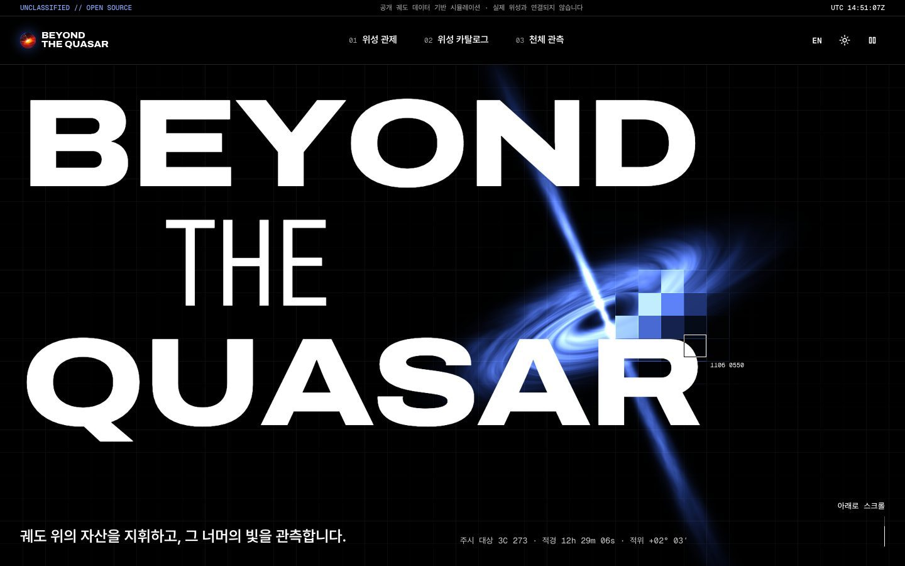 |  |

| 관제·관측과 진행 바 |
|---|
| 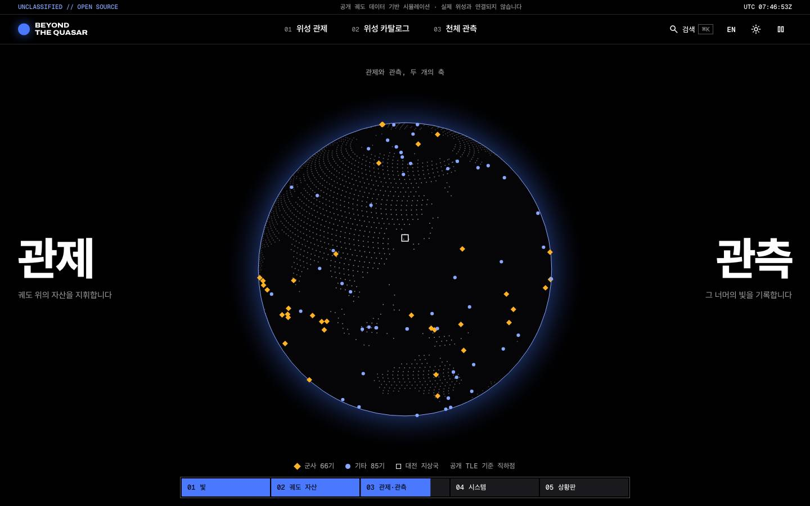 |

| 위성 관제: 지도 | 위성 관제: 지구본 |
|---|---|
| 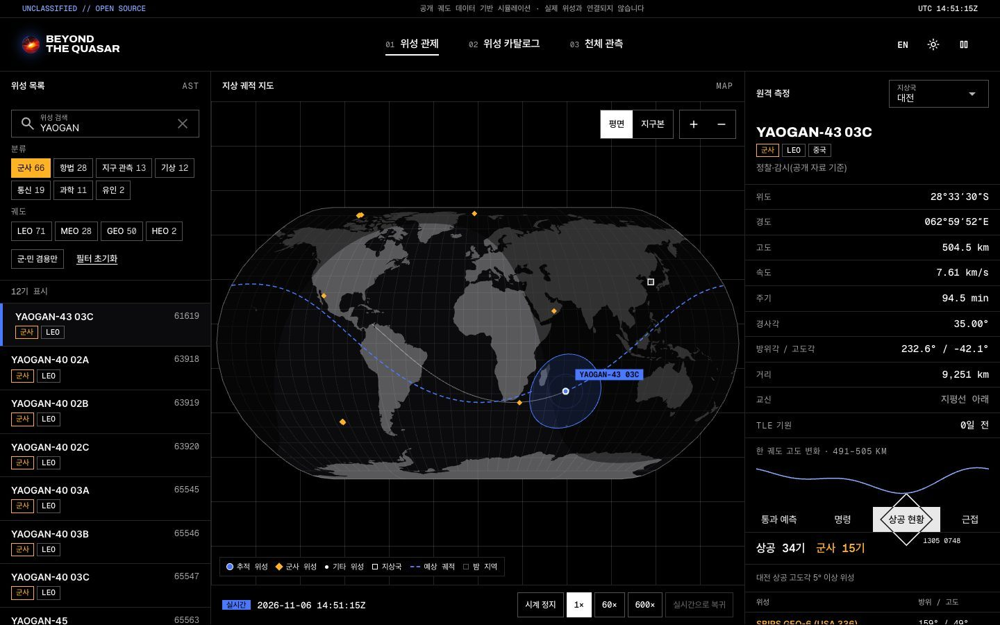 | 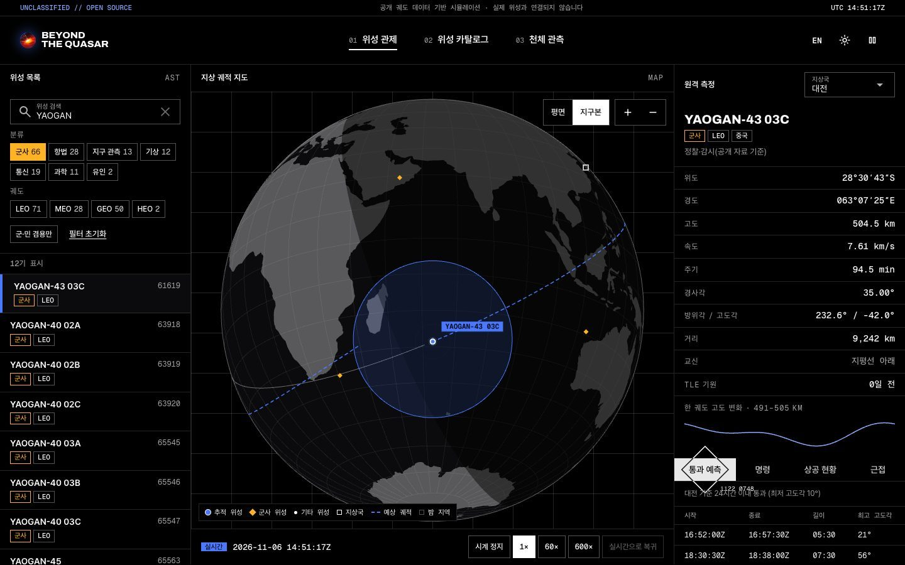 |

| 위성 카탈로그 | 위성 상세 |
|---|---|
| 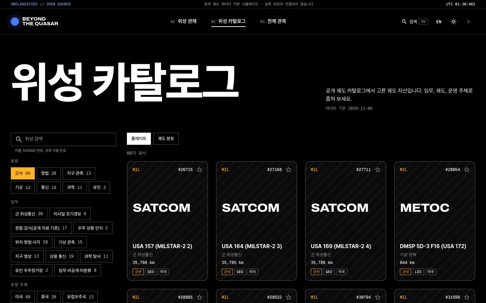 | 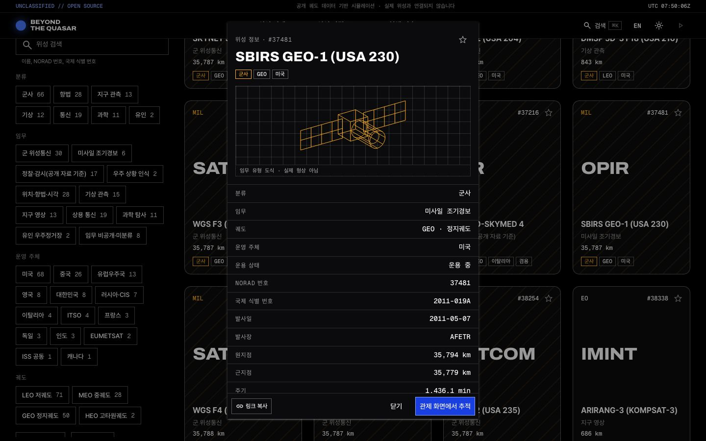 |

| 궤도 분포도 | 검색 팔레트 |
|---|---|
| 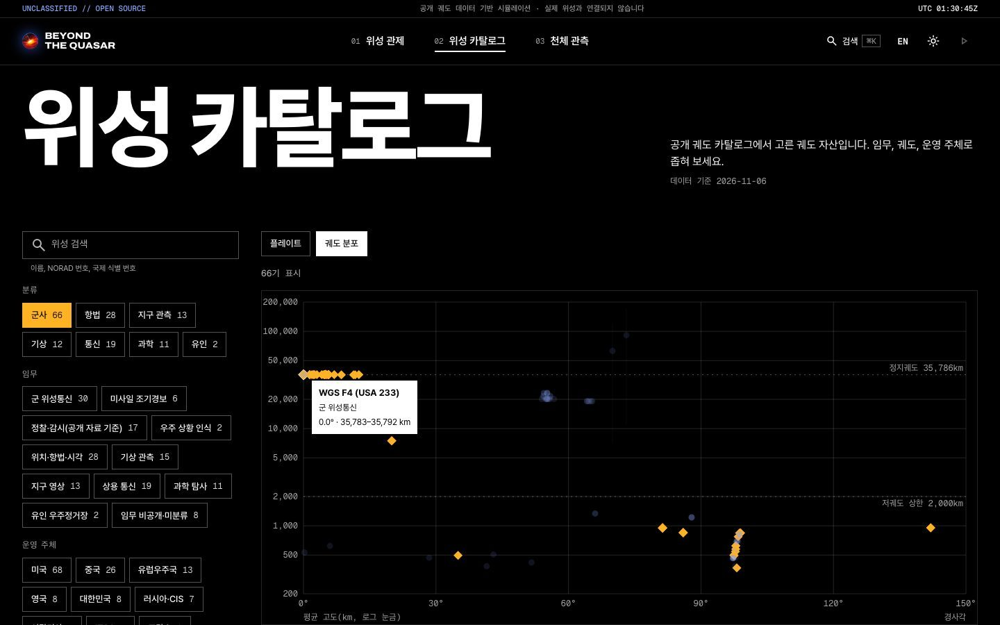 | 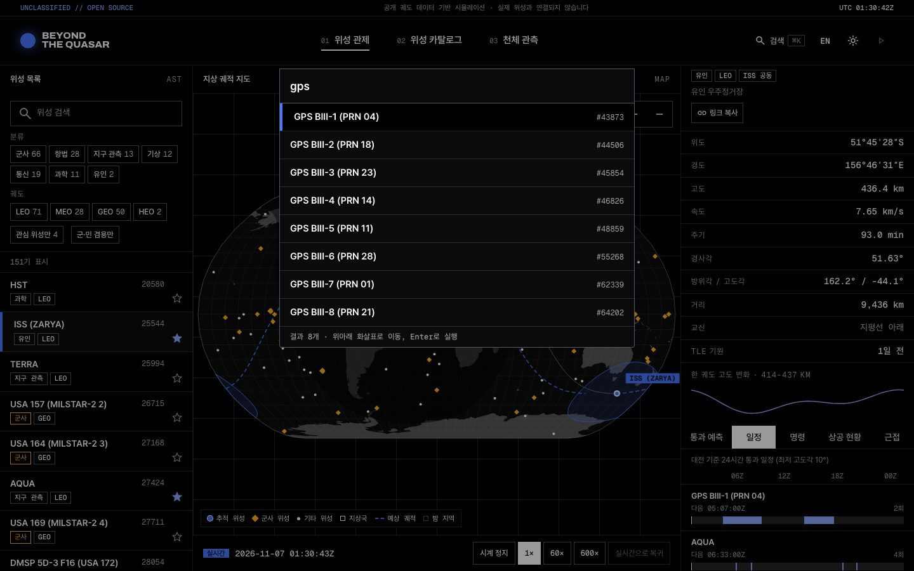 |

| 천체 관측 | 모바일 |
|---|---|
| 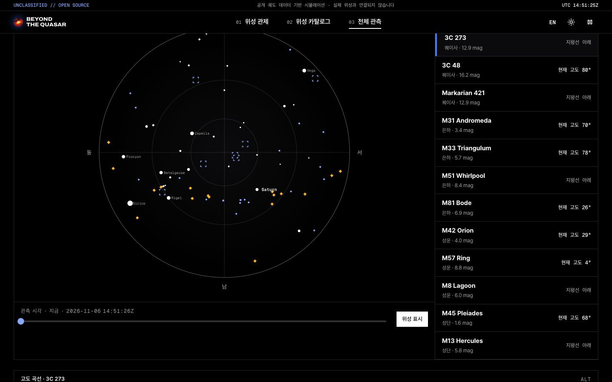 | 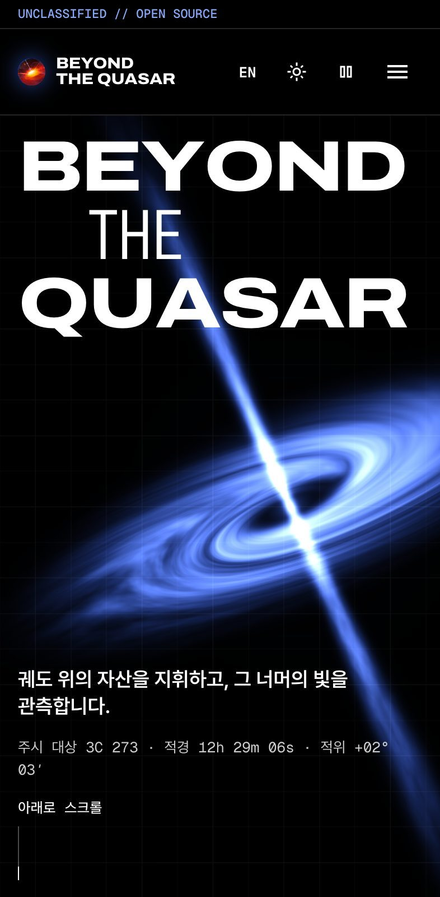 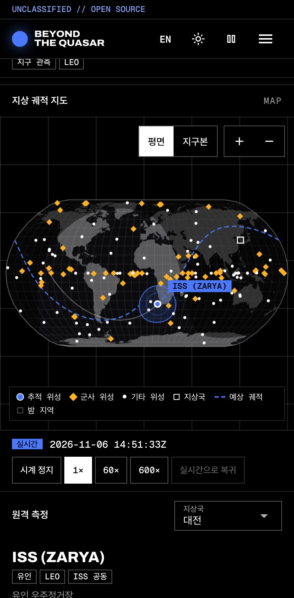 |

## 주요 기능

| 메뉴 | 내용 |
|---|---|
| 위성 관제 | 위성 151기 실시간 전파, 지상 궤적·가시 범위·낮밤 경계 지도(평면·지구본), 원격 측정, 통과 예측, 관심 위성 24시간 통과 일정, 지상국 상공 현황, 근접 위성, 임무 시계 배속, 시뮬레이션 명령 전송 |
| 위성 카탈로그 | 분류·임무·궤도·운영 주체·겸용 여부 필터와 검색, 플레이트 목록, 경사각·고도 궤도 분포도, 위성 상세(임무 유형 도식, NORAD 번호, 발사일, 원지점, 근지점 등) |
| 천체 관측 | 관측지별 일몰·박명·월출, 달 위상, 하늘 지도, 시각 조절, 퀘이사·은하·성운·성단 고도 곡선, 관측 일지 |
| 공통 | `Ctrl/⌘ K` 검색 팔레트, 관심 위성, 필터·위성이 담긴 공유 링크, 한국어·영어, 밝은·어두운 화면, 모션 정지 버튼과 동작 줄이기 대응 |

**위성 분류:** 군사(군 위성통신, 미사일 조기경보, 정찰·감시, 우주 상황 인식 등), 항법, 지구 관측, 기상, 통신, 과학, 유인. 비공개 위성은 공개 카탈로그에 없으므로 나오지 않습니다.

**모션:** WebGL 퀘이사(포인터 주변이 격자로 끊기는 셰이더), 격자 프리로더와 화면 전환, 스크롤에 맞물린 선언문·파란 점 전환·플레이트 펼침·축소되는 헤더, 글자 폭이 변하는 푸터, 스크롤에 따라 채워지는 구역 진행 바, 양쪽에서 모이는 관제·관측과 도는 점 지구본.

## 기술 스택


| 구분 | 사용 기술 |
|---|---|
| 프레임워크 | Vue 3.5, Quasar 2, TypeScript 5.9, Vite 7, Vue Router 5 |
| 상태·데이터 | Pinia 4, TanStack Query 5, VueUse |
| 궤도·천체 | satellite.js 6(SGP4), Astronomy Engine, d3-geo, world-atlas |
| 스타일·다국어 | UnoCSS, vue-i18n 11, Archivo·Pretendard·Geist Mono |
| 모션 | GSAP 3(ScrollTrigger), Lenis, WebGL 셰이더 |
| 품질 | oxlint, vue-tsc, Vitest, Vue Test Utils, Playwright, axe |
| 문서 | Histoire |
| 패키지·배포 | Bun, GitHub Actions, Vercel |

## 시작하기

Bun 1.4 이상이 필요합니다.

```bash
bun install
bun run dev    # http://localhost:5173
```

| 명령 | 설명 |
|---|---|
| `bun run build` / `preview` | 타입 검사 후 프로덕션 빌드 / 빌드 결과 실행 (`:4173`) |
| `bun run story:dev` / `story:build` | Histoire 개발 서버 / 빌드 |
| `bun run lint` / `typecheck` | oxlint / vue-tsc |
| `bun run test` | 단위·컴포넌트 테스트 |
| `bun run test:e2e` | 프로덕션 빌드의 레이아웃·접근성·업무 흐름 검사 (먼저 `build` 필요) |
| `bun run data:tle` | CelesTrak에서 궤도 스냅샷 갱신 |

## 프로젝트 구조

Feature-Sliced Design을 따릅니다.

```
public/data/     궤도 스냅샷 (tle-snapshot.json)
scripts/         스냅샷 생성 스크립트
e2e/             E2E 테스트
src/
├─ app/          진입점, 라우터, 전역 스타일, Histoire 설정
├─ pages/        홈, 관제, 카탈로그, 관측, 404
├─ widgets/      지도, 하늘 지도, 원격 측정, 퀘이사 셰이더, 플레이트 덱 등
├─ features/     위성 필터, 명령 전송, 관측지 변경, 임무 시계, 관측 일지, 환경 설정
├─ entities/     satellite, sky, observer, clock
└─ shared/       UI, 모션, 다국어, 유틸리티
```

## 문서

| 문서 | 내용 |
|---|---|
| [개발 가이드](docs/development.md) | 데이터 갱신, 모션 규칙, 접근성 점검, 테스트 |
| [버전 기록](CHANGELOG.md) | 버전별 변경 내용 |
