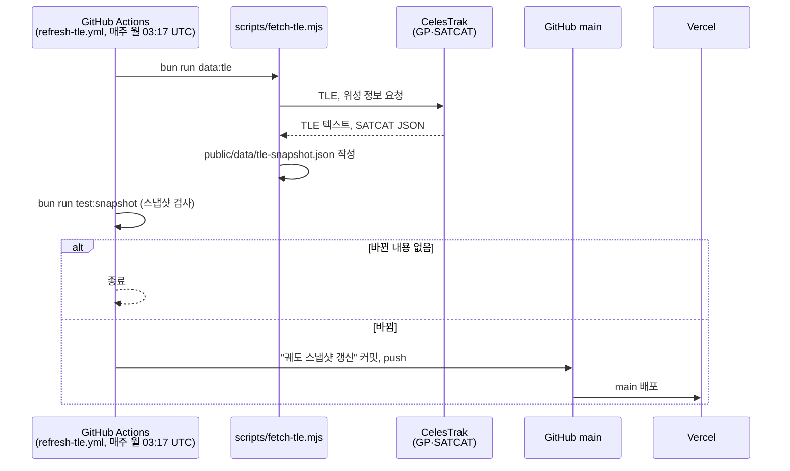
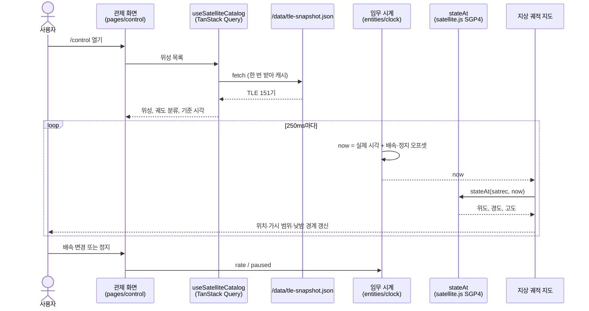
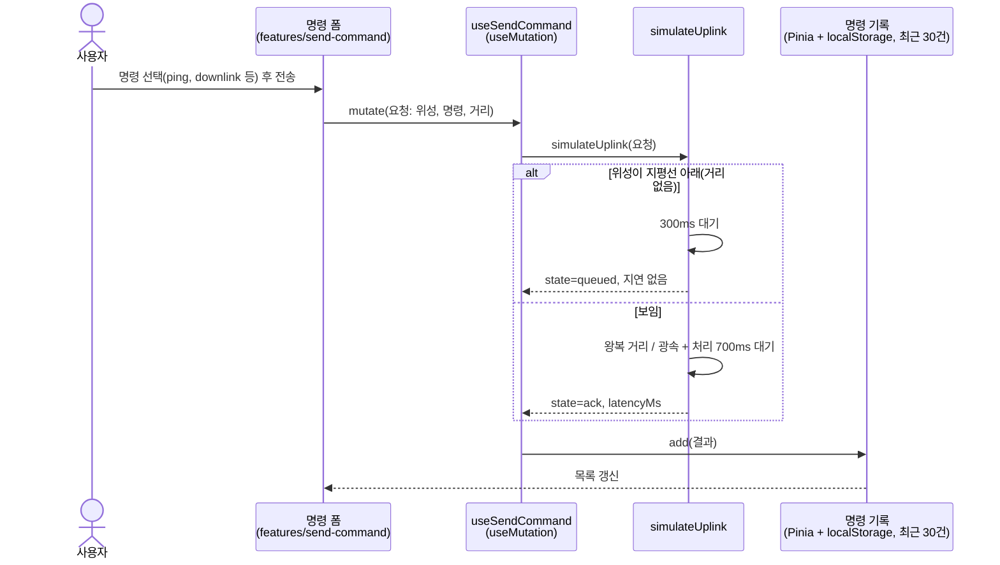

# 시퀀스 다이어그램

Beyond the Quasar는 서버 없이 동작합니다. 공개 TLE 스냅샷을 정적 파일로 배포하고, 위치와 통과 시각은 브라우저에서 계산합니다.

## 1. 궤도 스냅샷 갱신 (매주)

## 2. 관제 화면의 실시간 위치

## 3. 시뮬레이션 명령 전송

실제 위성에 보내지 않습니다. 지상국과 위성 사이 거리로 왕복 시간을 계산해 응답을 흉내 냅니다.

